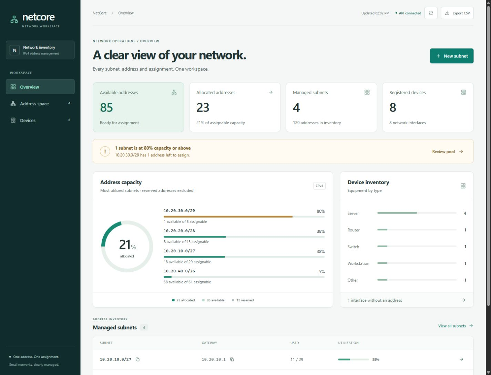

# NetCore

**A small, deliberate IP address management application.**

NetCore tracks IPv4 subnets, devices, and interface assignments. Its central problem is correctness: when two requests ask for the next available address, only one should receive it.

The application pairs a React operations dashboard with a Spring Boot API and Oracle persistence. It is a portfolio project with a runnable local workflow, an optional private deployment setup, and explicit limits.



*The dashboard running locally against the Spring Boot API and H2, with the reproducible sample inventory. These are demonstration records, not a discovered or monitored network.*

[Quick start](#quick-start) · [Architecture](docs/architecture.md) · [Deployment](docs/deployment.md) · [Demo walkthrough](docs/demo.md) · [Verification](docs/verification.md) · [Design review](docs/design-review.md)

## The workflow

1. **Create a subnet.** Generate a /24–/30 pool, reserving the network, broadcast, and optional gateway addresses.
2. **Register equipment.** Add devices and named interfaces with unique MAC addresses.
3. **Assign an address.** Request a specific IP or the next available one; see which device and interface owns it.
4. **Release and inspect.** Return an address to the pool, filter by state, or page through assignments.

The overview shows capacity calculated from stored records. Search finds subnets by CIDR/gateway and devices by name/type. CSV export downloads the loaded subnet summary. Connection failures are explicit; a failed initial load does not appear as an empty network.

Inspect a selected subnet's gateway, broadcast, and capacity; sort pools by utilization or remaining space. A visual map shows the current page of addresses. Selecting an available tile prepares the assignment form; submission still goes through the API's allocation checks. Pools at 80% utilization or above receive a capacity review prompt.

## Engineering decisions

| Decision | Why it exists |
| --- | --- |
| One transaction creates the subnet and pool | A failed insert cannot leave a partially created pool. |
| A pessimistic write lock on the subnet | Competing allocations and releases for that subnet make decisions in sequence. |
| Unique address constraint | Overlapping pools are rejected, including concurrent creation attempts. |
| Grouped status counts | Listing subnets uses two SQL queries rather than three counts for each subnet plus the list query. |
| Batched interface inventory | The dashboard makes three parallel inventory requests, independent of device count. |
| Flyway migrations + Hibernate validation on Oracle | Schema changes are versioned; startup checks the expected mapping. |

The query-count assertions run on H2 with multiple inventory records. They establish query behavior, not a latency benchmark. The Oracle integration profile also exercises the dashboard queries. See [how the system works](docs/architecture.md) for the trade-offs.

## Quick start

### Full stack with Docker

From the repository root, with Docker running:

```bash
docker compose up --build --wait --wait-timeout 600
```

Open [localhost:3000](http://localhost:3000). Oracle Free starts first, then the API, then the dashboard. The first build and Oracle initialization can take several minutes. Oracle data persists in a named volume.

The default Compose stack binds to localhost. Its default database password is for local development; copy [.env.example](.env.example) to an untracked `.env` to configure your own values.

### Development without Docker

Use Java 25 and Node.js 22. The Maven Wrapper is included.

```bash
# Terminal 1
cd backend
./mvnw spring-boot:run

# Terminal 2
cd frontend
npm ci
npm run dev
```

On Windows, use `.\mvnw.cmd spring-boot:run` in the first terminal.

Open [localhost:5173](http://localhost:5173). Vite forwards API calls to port 8080. This mode uses **in-memory H2**: data disappears when the backend stops.

### Load the sample inventory

With an empty running application, from the repository root:

```bash
node scripts/seed-demo.mjs
# Or, for Docker:
node scripts/seed-demo.mjs http://127.0.0.1:3000
```

Refresh the dashboard. The script creates four subnets, eight devices, eight interfaces, and 23 allocations through the public API. It only accepts localhost targets and leaves nonempty inventories untouched.

Follow the [five-minute walkthrough](docs/demo.md) to demonstrate creation, assignment, conflict handling, and release.

## Deployment

An optional Compose overlay adds **Caddy HTTPS and a shared reviewer password**. Database and API ports remain internal; only the gateway exposes public ports.

```bash
docker compose -f compose.yaml -f compose.deploy.yaml up --build --wait --wait-timeout 600
```

This command needs a server, DNS name, and the required environment values first. The [deployment guide](docs/deployment.md) covers setup, access checks, persistence, and updates.

This is a private demonstration configuration. It does not implement individual accounts, roles, or an audit log. No public deployment is implied by the presence of these files.

## Verification

```bash
# Backend unit, persistence, REST, concurrency, and inventory query-count tests
cd backend
./mvnw verify

# Oracle migrations and integration behavior; requires Docker
./mvnw -P oracle-integration verify

# Frontend formatting, type checking, and production build
cd ../frontend
npm ci
npm run format:check
npm run build
```

On Windows, replace `./mvnw` with `.\mvnw.cmd`. GitHub Actions defines backend, Oracle, frontend, and container checks. The [verification record](docs/verification.md) distinguishes checks actually run locally from checks requiring Docker or a hosted environment.

## API at a glance

All routes below are relative to `/api/v1`.

| Action | Endpoint |
| --- | --- |
| Create or list subnets | `POST /subnets` · `GET /subnets` |
| Page/filter addresses | `GET /subnets/{id}/addresses?status=AVAILABLE&page=0&size=20` |
| Allocate next available | `POST /subnets/{id}/allocate-next` |
| Allocate a specific address | `POST /subnets/{id}/addresses/{ip}/allocate` |
| Release an address | `POST /subnets/{id}/addresses/{ip}/release` |
| Create or list devices | `POST /devices` · `GET /devices` |
| Add or list a device's interfaces | `POST /devices/{id}/interfaces` · `GET /devices/{id}/interfaces` |
| List all interfaces and assignments | `GET /interfaces` |

Subnet creation accepts `{"networkAddress":"10.20.30.0","prefixLength":29,"gatewayAddress":"10.20.30.1"}`. Allocation accepts `{"networkInterfaceId":1}`. Invalid state transitions and duplicate allocations return structured conflict errors.

## Deliberate limits

- **IPv4, /24–/30 only.** One row per address makes this bounded model easy to inspect; it does not suit IPv6 or very large pools.
- **One address space.** No VRFs or overlapping routing domains.
- **Inventory, not provisioning.** NetCore does not scan networks, configure devices, or operate DHCP/DNS.
- **Per-subnet serialization.** Correctness is prioritized over maximum allocation throughput.
- **Small inventory lists.** Address pools are paginated; subnet, device, and interface lists are not.
- **Refresh-based snapshots.** The dashboard refreshes after writes or on request; it is not a live monitoring system.

The interesting part is the transaction, constraint, and concurrency reasoning. The [demo guide](docs/demo.md) maps those decisions back to the code.
